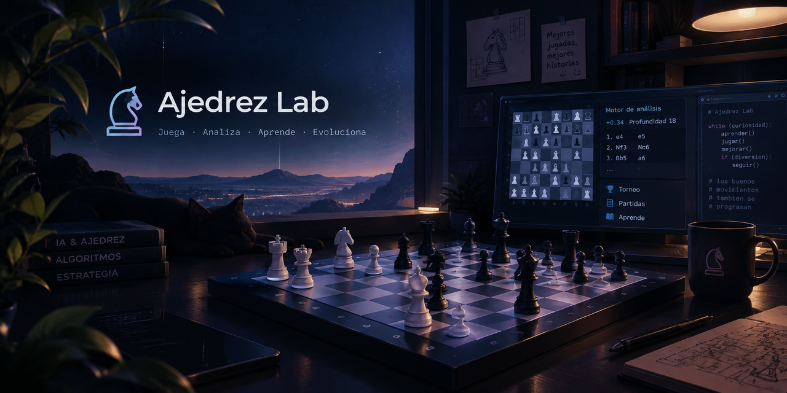
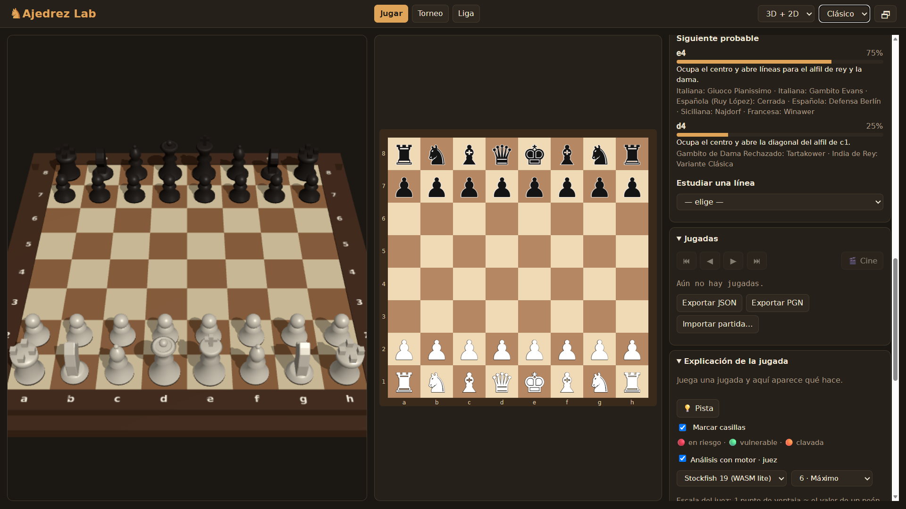
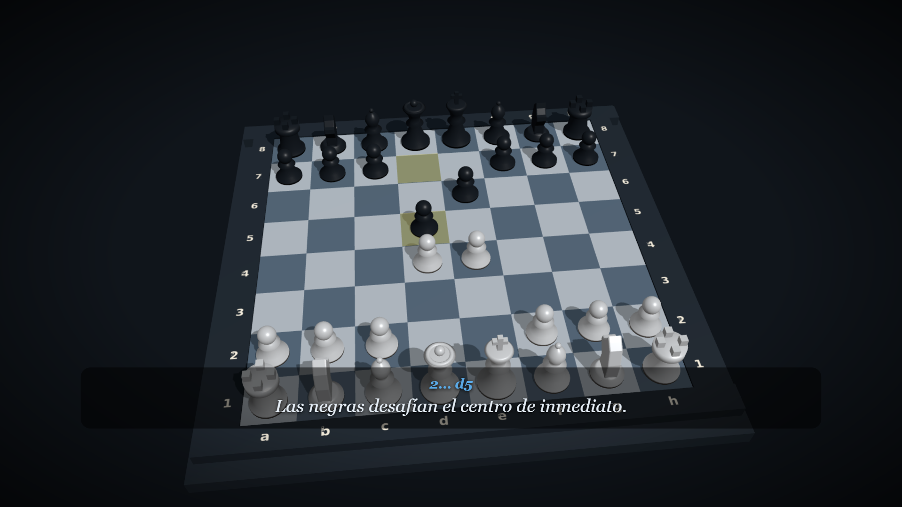
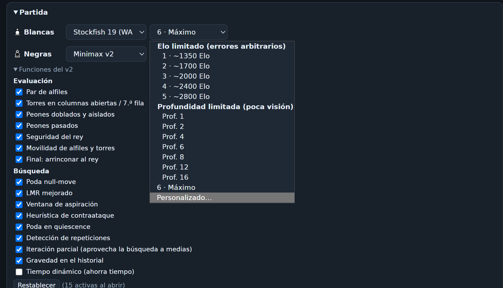
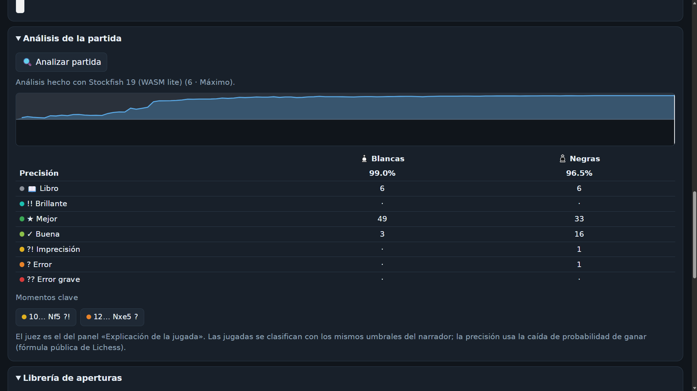
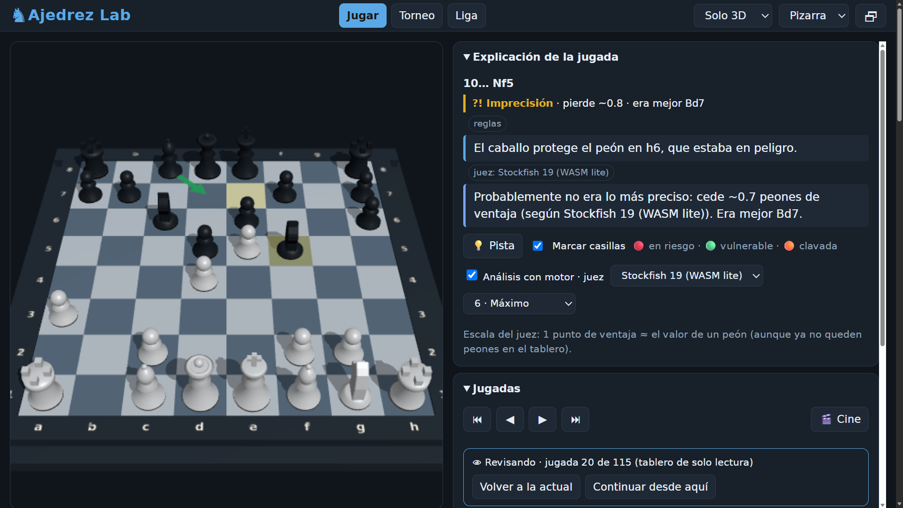
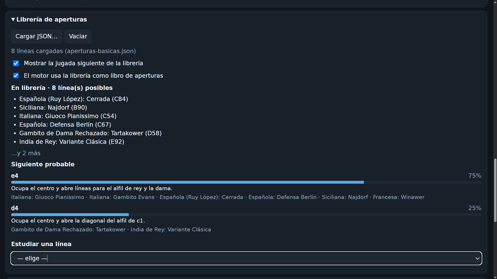
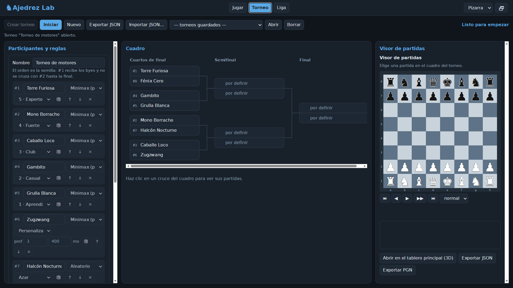
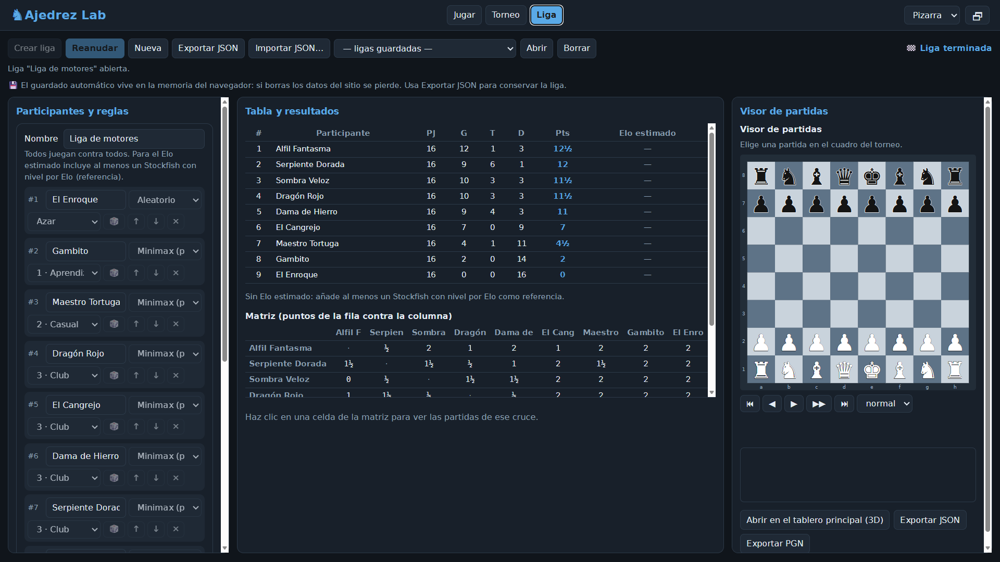

<div align="center">
  


# Ajedrez Lab

### ♞ [Jugar](https://mialmoga.github.io/Ajedrez-Lab/)

</div>
Laboratorio de ajedrez **modular y sin bundler** (módulos ES nativos): tablero 3D + 2D sincronizados,
motores intercambiables, librería de aperturas/partidas explicadas en JSON con detección de la
línea que se está abriendo, e intercambio por PNG para jugar contra una IA sin API.

## 📸 Capturas

<table>
  <tr>
    <td align="center"><br><sub>3d + 2d</sub></td>
    <td align="center"><br><sub>Replay en Modo Cine</sub></td>
  </tr>
  <tr>
    <td align="center"><br><sub>Experimenta partidas entre motores</sub></td>
    <td align="center"><br><sub>Aprende de tus errores</sub></td>
  </tr>
  <tr>
    <td align="center"><br><sub>Narrador y análisis de presición</sub></td>
    <td align="center"><br><sub>Librería de aperturas</sub></td>
  </tr>
  <tr>
    <td align="center"><br><sub>Torneo</sub></td>
    <td align="center"><br><sub>Liga</sub></td>
  </tr>
</table>

---

## Arrancar

```bash
python3 -m http.server 8090      # o: npm start
# abre http://localhost:8090
```

Pruebas puntuales (motor, partida, librería, PNG, torneo, worker): `npm test`

## Qué hace

- **Modos**: humano vs máquina, máquina vs máquina (cada lado con su motor y nivel) y humano vs humano.
  Se elige en el panel *Partida*.
- **Motor propio** (`src/engines/minimax`): negamax + alfa-beta, tabla de transposición, quiescence,
  profundización iterativa, en un Web Worker. 5 niveles + modo personalizado (profundidad/tiempo).
- **Librería JSON**: carga tus archivos; cada jugada puede llevar una explicación. Mientras juegas,
  el panel muestra qué líneas siguen vivas, la jugada siguiente más probable (con %), explica tu última
  jugada y avisa cuándo sales de la librería. Detecta transposiciones (compara posiciones, no orden).
  Opcional: el motor puede usar la librería como libro de aperturas.
- **Torneo** (pestaña *Torneo*): eliminatoria directa entre motores con participantes que **tú nombras**, cuadro en SVG,
  visor de partidas con gráfica de evaluación, autoguardado y exportación/importación en JSON para reproducirlo después.
  Ver [docs/TORNEO.md](docs/TORNEO.md).
- **Fuente embebida** (DejaVu): el texto y las piezas del PNG y del 2D se ven igual en cualquier máquina.
- **PNG**: exporta la posición como imagen (con FEN, turno y últimas jugadas impresos y el estado
  incrustado en los metadatos); pega la respuesta de una IA como texto libre.

## Estructura

```
index.html          import map (three) y punto de entrada
src/core/           Game (reglas, estado), Match (quién juega), EventBus
src/engines/        contrato de motor, registro y motores (minimax, random)
src/ui/             vistas 2D/3D, controlador de tablero, paneles, temas
src/library/        carga del JSON, índice por posición, detector de aperturas
src/tournament/     cuadro (bracket), partidas sin interfaz, torneo, guardado
src/exchange/       PNG (render + metadatos) y lectura de jugadas en texto libre
library/            tus JSON (index.json lista los que se cargan al arrancar)
vendor/             chess.js 1.4.0, three 0.186 y fuentes DejaVu (copiados, sin npm)
docs/               arquitectura, formato JSON, motores, intercambio PNG
tests/              pruebas puntuales
```

## Documentación

- [docs/ARQUITECTURA.md](docs/ARQUITECTURA.md) — módulos, eventos y cómo reemplazar piezas
- [docs/FORMATO-JSON.md](docs/FORMATO-JSON.md) — formato de la librería de partidas/aperturas
- [docs/MOTORES.md](docs/MOTORES.md) — cómo escribir/enchufar un motor (Stockfish WASM, redes neuronales…)
- [docs/TORNEO.md](docs/TORNEO.md) — torneos de eliminación directa y su formato JSON
- [docs/INTERCAMBIO-PNG.md](docs/INTERCAMBIO-PNG.md) — jugar contra una IA pasándole imágenes

## Notas honestas

- El motor propio es de nivel "club decente": ~100–200 mil nodos/s, profundidad 6 en medio juego en
  unos 3 s. Para más fuerza, la idea es enchufar Stockfish WASM como segundo motor (ver docs/MOTORES.md).
- El motor usa la **API interna** de chess.js 1.4.0 por velocidad; por eso `vendor/chess` está fijado.
- La vista 3D usa piezas procedurales (sin modelos externos). Requiere WebGL; sin él, usa la vista 2D.

- [docs/EXPLICADOR.md](docs/EXPLICADOR.md) — explicador de jugadas (detectores + diccionario editable)
- [docs/LIGA.md](docs/LIGA.md) — liga todos contra todos y Elo estimado
- [Partidas sueltas: revisar, exportar, importar](docs/PARTIDAS.md)
- [docs/MINIMAX2.md](docs/MINIMAX2.md) — Minimax v2 (funciones activables; el v1 queda como referencia)
